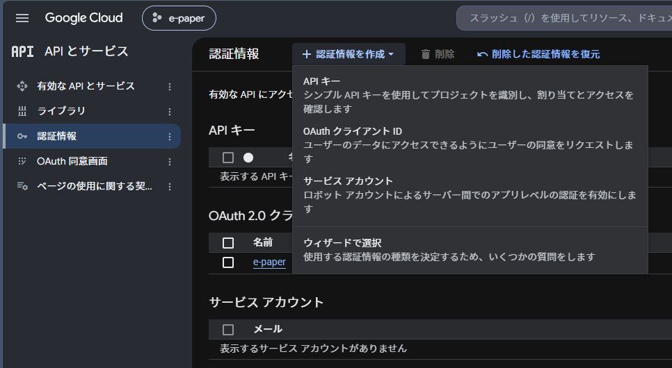
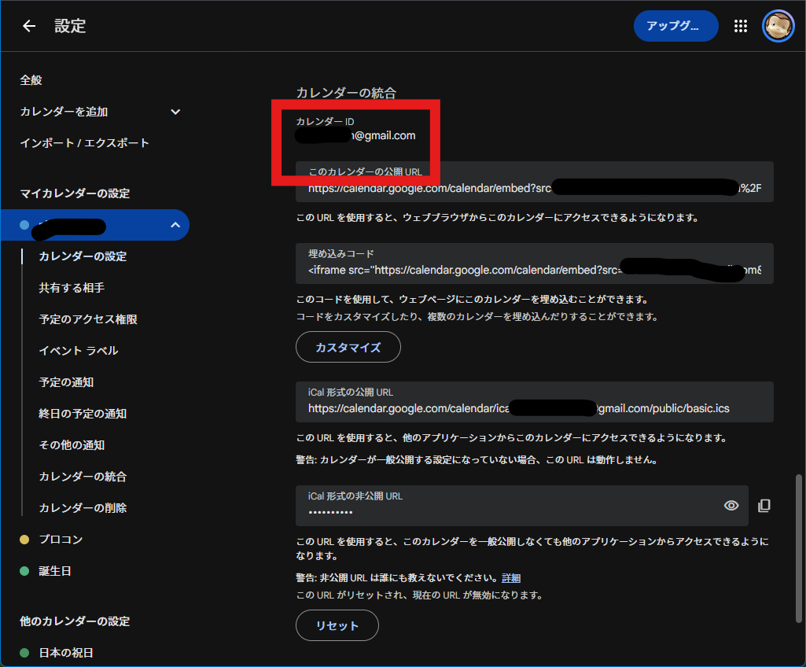

## awesome-epaper

Waveshare 7.5inch e-paper Bにカレンダーや写真を表示させるリポジトリです

Raspberry Pi上でFastAPIサーバを動かし、適当なブラウザでアクセスするとダッシュボードが表示されます。

calendar/image/test/clearの4モードから選んでdraw!ボタンを押下すると、その場で描画と実機表示まで行います

描画するたびに結果のプレビューPNGが `src/img/image.png` に同じファイル名で上書き保存されるためデバッグに有効

実行環境は raspberrypi 3b で検証、開発環境は適当なlinux環境ですが、e-paperに描画することができないので環境変数で対応しました。

~~raspberrypi zero w でも動作検証予定~~
動作しました


```
src/
├── waveshare_epd/        # Waveshare純正ドライバ
├── clear.py              # e-paperを白紙に戻す手動ユーティリティ
├── main.py               # FastAPIアプリ
├── google_auth_setup.py  # 初回のみのOAuth認証
├── epd_7in5b_V2_test.py  # テストコード
├── secret.py.example     # secret.pyのひな形
├── static/index.html     # ダッシュボード
├── pic/                  # epd_7in5b_V2_test.pyが使うフォントと写真
├── img/                  # プレビューPNGの書き出し先
└── lib/                  # 描画エンジン・データ取得まわり
    ├── draw.py              # 800x480の黒面/赤面キャンバスへの描画エンジン
    ├── draw_calendar.py     # カレンダー画面の組み立て
    ├── google_calendar.py   # Googleカレンダーからの予定取得
    ├── google_tasks.py      # Google Tasksからのタスク取得
    ├── google_auth.py       # Calendar/Tasks共通のOAuth2認証情報ロード・更新・永続化
    ├── epd_backend.py       # EPD_MODEで実機/開発モックを切り替えるEPD生成
    ├── requestAPI.py        # 祝日API等の汎用GETヘルパー
    └── misakifont/          # 日本語ビットマップフォント
```


## e-paepr

私はこのe-paperを使いました。ほかのものでも使えないこともないですが、サイズ等違うので調整してください

https://www.waveshare.com/pico-epaper-7.5-b.htm


必要に応じて以下のリポジトリからドライバー置き換えてください

https://github.com/waveshareteam/e-Paper/tree/master/RaspberryPi_JetsonNano/python/lib/waveshare_epd


## raspberry pi setup

### 1. venv

```bash
cd ~/epaper
python -m venv .venv
source .venv/bin/activate
```

### 2. install

普通に入れます。 `requirements.txt`は共通のライブラリです。**開発時は6までスキップしてください。**

```bash
pip install -r requirements.txt
```

---

ここから本番時の環境構築です。

`spidev`はCコンパイルが必要なので、先にビルド環境を入れます。

```bash
sudo apt install -y python3-dev build-essential swig
pip install -r requirements-hardware.txt
```


### 3. SPI

```bash
sudo raspi-config
```
`Interface Options -> SPI -> Enable`

有効化後は一度再起動しておくと確実です


### 4. lgpio install
gpiozeroはデフォルトだとlgpio/RPi.GPIO/pigpioで不安定になることがあるのでlgpioを入れて解消します

`liblgpio`本体はpipでは入らないので、ソースからビルドする必要があります

```bash
cd ~
git clone https://github.com/joan2937/lg.git
cd lg
make
sudo make install
sudo ldconfig
```

### 5. e-paper 確認

```bash
cd ~/epaper
python src/epd_7in5b_V2_test.py
```

https://github.com/waveshareteam/e-Paper/tree/master/RaspberryPi_JetsonNano/python/lib/waveshare_epd

./src/waveshare_epd に必要に応じて↑のリポジトリから配置してください。 epdconfig.py は変更不要です。

デフォルトで最初に紹介したe-paperのドライバを配置しています。


gpio対応は↓にまとめてます

https://nishima-tech.com/article/pico-epaper/


### 6. Google Calendar / Tasks 連携の準備

OAuth2でブラウザのあの認証を通してリフレッシュトークンとかが書かれた `token.json` を入手する必要があります。

#### 6-1. GCP側の準備

1. GCP ConsoleでCalendar APIとTasks APIの両方を有効化
2. APIとサービス -> 認証情報 -> 認証情報を作成 -> OAuthクライアントID -> デスクトップ アプリ を選択して作成
3. 発行されたクライアントシークレットJSONをダウンロードし、`src/`に配置



ファイル名は任意、`secret.py`で指定します


#### 6-2. secret.pyの準備

```bash
cd ~/epaper/src
cp secret.py.example secret.py
```

`secret.py` を編集し、`GOOGLE_OAUTH_CLIENT_SECRET_FILE`（ダウンロードしたJSONのファイル名）と `GOOGLE_CALENDAERID`（カレンダーID）を実際の値に書き換えてください

https://calendar.google.com/calendar/u/0/r/settings

カレンダーIDはGoogleカレンダーの設定を開き、左にあるマイカレンダーをクリック、下に行くとあります



デフォルトのカレンダーは自分のgmailのアドレスそのままです


#### 6-3. 初回認証

ヘッドレスの場合はSSHのポートフォワードで、GUIがある場合は表示されるリンクをブラウザで開きます


**ヘッドレスの場合**：SSHクライアントからポートフォワーディングでラズパイにSSH接続します。ポート番号は43211
```bash
ssh -L 43211:localhost:43211 <user>@<Piのアドレス>
```


```bash
cd ~/epaper
source .venv/bin/activate
cd src
python google_auth_setup.py
```

コンソールに表示されるURLをブラウザで開き、Googleの同意画面を通します

ブラウザは`http://localhost:43211/...`にリダイレクト、スクリプトが自動的に検知し`src/lib/token.json`を生成して終了します

以降のサーバ起動時はこのファイルから自動的に認証情報を読み込むのでブラウザ操作は不要になります

`token.json`の中身が失効・取り消しされた場合は`google_auth_setup.py`を再実行すればOK


### 7. サーバを起動する

```bash
cd ~/epaper
source .venv/bin/activate
uvicorn main:app --app-dir src --host 0.0.0.0 --port 8000

# 開発環境
EPD_MODE=mock uvicorn main:app --app-dir src
```

開発環境は`EPD_MODE`を`mock`に指定してください


#### 開発用の実行環境 EPD_MODE

`EPD_MODE`でe-paperへの出力先を切り替えます。

API周りは共通ですが、`mock`の時は画像に書き出すだけにします。

変数を省略すると本番環境になるので、開発環境のの場合はエラー出るので注意


## エンドポイント

- `GET /` — ダッシュボード`src/static/index.html` 
- `POST /draw/calendar` — カレンダーを再描画し、そのまま実機のe-paperに表示
- `POST /draw/clear` — e-paperを白紙にクリア
- `POST /draw/test` — `src/epd_7in5b_V2_test.py`を実行
- `POST /draw/image` — アップロードされた画像を800x480にリサイズして実機に表示

`/draw`系エンドポイントはいずれも呼ぶたびに `src/img/image.png` にプレビュー画像を同じファイル名で上書きするので、実際の描画を確認できます。


## contact
`contact@nishima-tech.com`


---
このリポジトリは以下のリポジトリを継承・統合しています

https://github.com/mitsuiJao/e-paper-server

https://github.com/mitsuiJao/e-paper-client
